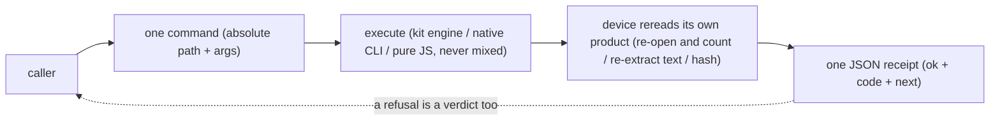

# Agent Doc Ops (dockit, Open Source Edition) v3.2.0

[](#license)
[](#install--reproduce)
[](#install--reproduce)
[](#verification)

**Absolute path + one command + one JSON line**: a document-operations device
for any agent on this machine, wrapping a prebuilt LibreOffice engine
([`@deepseek-ai/libreoffice-kit`](https://github.com/deepseek-ai/dsh-libreoffice-kit)
 --  npm package name `libreoffice-kit`, repo dir prefixed `dsh-`; DeepSeek open
source, MPL-2.0)  --  convert/render/recalculate/inspect/scrub/extract/
merge-split/fill forms. Inputs are read-only, products are always new files,
nothing is ever overwritten, and deliveries carry font and metadata evidence
with them. Badges above are documentation images, not packages: `npm install`
pulls exactly three dependencies, the rest is reported by `doctor`.

> First use? Start with [One-line calls](#one-line-calls): any agent that can
> run a Node command integrates under the same contract; failures are read by
> `code`, never by exit code; full flag tables live behind `help <command>`.

> Chinese edition: [README.md](README.md)

## Contents

- [Highlights](#highlights)
- [Why this design](#why-this-design)
- [What one call walks through](#what-one-call-walks-through)
- [One-line calls](#one-line-calls)
- [Commands](#commands)
- [Cost notes](#cost-notes)
- [Three copy-paste roads](#three-copy-paste-roads)
- [Install the skill into an agent dir](#install-the-skill-into-an-agent-dir)
- [One-command setup flow](#one-command-setup-flow)
- [Font loader](#font-loader)
- [Operating boundaries](#operating-boundaries)
- [Verification](#verification)
- [Install & reproduce](#install--reproduce)
- [Self-test](#self-test)
- [Repository layout](#repository-layout)
- [License](#license)

## Highlights

|  | in one line | where to read on |
|---|---|---|
| **Inputs read-only, never overwrite** | originals sha256'd before and after, mismatch halts with `failed`; existing outputs are refused, never replaced; no half-written products | [Operating boundaries](#operating-boundaries) |
| **Prove it, don't claim it** | the device re-opens and recounts its own products; a backend `success` is not a conclusion (only counted evidence is) | [Operating boundaries](#operating-boundaries) |
| **Real redaction, not black boxes** | `redact` deletes content-stream text operators + paints boxes + re-extracts the product text layer; any residual needle is `failed` | [Commands](#commands) |
| **De-sensitization as shape, not slogan** | inspections report field names + lengths; body text/author/link targets never echo; diagnostics fold paths to placeholders | [Operating boundaries](#operating-boundaries) |
| **Numbers are machine-kept** | judge count, mutant count and entry counts are machine shapes re-computed by judges; drift turns red | [Verification](#verification) |
| **Missing pieces don't pretend** | absent engines/backends/language packs return `unavailable` + pointers; judges SKIP by name, never claim coverage | [Install & reproduce](#install--reproduce) |

## Why this design

- **Callers don't read source.** Agents integrate as "absolute path + one command + one JSON line": the surface, flag meanings and failure codes are always read back live from `help`. This README carries no second copy that could drift.
- **"Success" must prove itself.** Conversions are read back, redactions re-extract text, slimming proves page-count + byte-identical text  --  "backend exit 0" is never the conclusion; the device's own reread is.
- **The device holds no risk for the caller.** Size gates, never-overwrite, encrypted-input refusal, scanned-PDF rerouting to OCR: undoable surfaces refuse up front instead of producing "looks successful" shapes.

## What one call walks through



A refusal is a verdict too: pre-gates (size/overwrite/encryption/format) fire
before any unpacking or writing. No half-finished products.

Version v3.2.0. Authority: this README (command surface master) + `docs/adr/`
(key design decisions). Discipline: inputs read-only, products default to
`_out/` (except `DOCKIT_OUT_DIR` test redirect / `_audit` ledger / gc
quarantine), never overwrite; temp files see Operating boundaries
(`_tmp/` + system-Temp ASCII reroute, deleted after use).

## One-line calls

```bat
node <REPO>\dockit.js <command> [args...]
```

`<REPO>` is this repo's clone dir (see Install & reproduce). Or the sibling
`dockit.bat` in the same dir (same thing, less typing):

```bat
<REPO>\dockit.bat doctor
```

Exit code `0` success / `1` failure; on failure that stdout JSON line carries
`code` (whose failure family) and `next` (what to do next). **Nothing existing
gets overwritten, inputs are never modified.**

## Commands

| command | what it does | example |
|---|---|---|
| `doctor` | Environment self-proof: Node>=22.19, kit + engine present, `capabilities` vs coded matrix, `_out/_tmp` writable, font dir readable, substitute-font sentinels, VC++ v14 present, Tesseract + chi_sim sentinels, OfficeCLI backend presence, pdf-lib/fontkit/pandoc/poppler sentinels | `dockit.bat doctor` |
| `to` | Convert, routed by output suffix; omitted output lands auto-deduped in `_out/`; misaligned OLE inputs auto-repair from a copy and self-report | `dockit.bat to D:\report.docx` (to PDF) |
| `pages` | Render per-page PNGs + manifest + **per-page non-white pixel ratio** (proof text really drew, not blank pages) | `dockit.bat pages report.docx --pages 1,3 --dpi 96` |
| `ocr` | Tesseract OCR (**external dep**): single PNG or PDF (render-then-read per page); per-page lines/chars/pixel-ratio self-reported plus the language list of the directory actually used; missing engine returns `unavailable` + pointers; empty results are data, not errors | `dockit.bat ocr img.png --lang eng` |
| `sheets` | List worksheet names. `zip` reads OOXML directly (no engine), `render` asks the engine; `auto` self-reports which road answered | `dockit.bat sheets book.xlsx` |
| `inspect` | Inspect: container by magic bytes (**never by suffix**), conversion matrix, declared font families, metadata field **shapes** (names + lengths, body never echoes). PDF inputs additionally get a pure-JS `pdf` block: page count/sizes/rotation/encryption, font embedding verdicts, interactive-form probe. `--deep` attaches real-conversion `missingFonts` | `dockit.bat inspect report.docx --deep` |
| `recalc` | Recompute workbook formulas (formulas kept, values refreshed). `--verify` diffs cached values cell by cell (ZIP xlsx/ods only) | `dockit.bat recalc book.xlsx --verify` |
| `scrub` | Scrub metadata, OOXML+ODF since v1.6.0, PDF since v2.5.0: `docProps`, `meta.xml` nine fields + thumbnail removal, `/Info` keys + XMP removal -> new file, never in place. `--verify` rereads the product for zero residue | `dockit.bat scrub report.docx --verify` |
| `dump` | Package shape self-description, engine never started: part list + per-XML-part element/attribute counts and names; body text only with explicit `--text`; metadata parts shape-only. Three caps, overruns self-report `truncated` | `dockit.bat dump D:\report.docx` |
| `factcheck` | Check hard-coded point-in-time facts in docs: counts, file/line calibers, negative assertions; `--strict` gates, `--refs` checks `file:line` references | `dockit.bat factcheck`; `factcheck --refs` |
| `verify` | Cross-check two text-extraction roads of one source (text layer vs render+OCR): per-page matches, A-only lines (undrawn glyphs), B-only lines (phantoms). PDFs walk the render half only (`mode:render-only`) | `dockit.bat verify report.docx --lang chi_sim` |
| `check` | Pre-send shape inspection, no engine, no writes: 13 families (metadata fields, stale formula caches, missing alt text, empty tables/pages, CRC fights, hidden content, external refs, embedded objects, macros/scripts, custom XML, form fields). Values never echo; coverage self-reports applicable vs not-applicable kinds; `--backend officecli` adds one upstream schema pass | `dockit.bat check D:\report.docx` |
| `edit` | **Write op** (OfficeCLI backend, see `docs/adr/ADR-002-*`): copy-first to `_out/<name>-<UTC>-work.<ext>`, backend touches the copy only; original sha256 before+after; the device re-reads the value itself (backend `success` is not a conclusion); backend stdout never relayed. Bring-your-own backend (not shipped, see boundaries) | `dockit.bat edit D:\book.docx add /body --type paragraph --prop text=note` |
| `merge` | Template fill: `merge <template> <data.json> [output]`, `{{key}}` replaced. Template checksummed before+after (zero change); data must be a JSON file path (top-level object, all-scalar values); existing output refuses; backend `--force` never passed. Bring-your-own backend | `dockit.bat merge D:\template.docx D:\data.json` |
| `media` | Extract embedded media to a dir + manifest (type/bytes/sha256). OOXML/ODF by unpacking (no engine); PDF via poppler `pdfimages` (count with `-list` first, refuse before landing over cap). Previews out of scope; encrypted PDFs refused | `dockit.bat media report.docx` |
| `batch` | Directory batch: each file through `to` (PDF default, one level; `--recursive` descends), per-file JSON + ledger; one failure never sinks the rest. `--cmd to|markdown` selects the per-file command face | `dockit.bat batch D:\work --ext .doc,.docx` |
| `combine` | Merge PDFs in argument order: inputs read-only (hashes in `sources[]`), product new, never overwrite; encrypted/form PDFs out of scope | `dockit.bat combine A.pdf B.pdf` |
| `split` | Split PDF by `--ranges`, `--every n`, or per-page default; products in a new dir with per-file page counts; 100-item cap | `dockit.bat split bundle.pdf --every 10` |
| `pdftext` | Take a PDF's embedded text layer straight (poppler `pdftotext`, no OCR): text lands in `.txt` only, JSON reports counts (**body never echoes**, same privacy caliber as ocr); single-range `--pages`; non-PDF/encrypted/missing-poppler refused or rerouted | `dockit.bat pdftext report.pdf --pages 1-3 --out excerpt.txt` |
| `pageops` | PDF page ops (pdf-lib): `rotate 90/180/270`, `delete`, `order`; inputs read-only, products new; encrypted unsupported | `dockit.bat pageops bundle.pdf rotate 90` |
| `pipeline` | Chain steps: comma flow (`to,pages,ocr`) or `--dag flow.json` graph executor (needs/conditional branches, deterministic topo order; concurrency explicitly not done) | `dockit.bat pipeline report.docx to,pages,ocr` |
| `markdown` | Docs to GFM Markdown (pandoc backend): docx/odt/pptx/xlsx/csv/tsv/html; old families via `to` first; `--wrap` + docx-only `--track-changes`; missing pandoc returns `unavailable`; only `.md` lands, body never echoes | `dockit.bat markdown D:\notes.md --to docx` |
| `pdfform` | Controlled AcroForm fill (pdf-lib): AcroForm only (XFA/encrypted refused, signature fields untouched); `--list` fields, `--data` fills, CJK auto-embedded fonts, `--flatten` irreversible; values never echo; product reloaded and re-read field by field | `dockit.bat pdfform form.pdf --list` |
| `redline` | docx tracked-changes + comments write (pure ZIP+XML, zero external deps): insert/delete/comment/accept/reject with device reread-back; format-change reject refuses (no fake restores) | `dockit.bat redline D:\report.docx insert --text "note one" --match "chapter 3" --author rev` |
| `redact` | **True PDF redaction, optional whitespace-only mode** (v2.7.0, `--fill none` added v3.1.0; pdf-lib+poppler): `redact <in.pdf> [--needle str] [--needles data.json] [--fill black|none] [--out file] [--dry-run]`. Three load-bearing parts: `pdftotext -bbox` word boxes locate, **hit BT...ET text groups deleted from page streams** + black boxes by default (`--fill none` deletes without painting, the "drop redundant entries" use), product text layer re-extracted to prove **zero needle hits**. Painting boxes without deleting is fake redaction. Missing needle / textless scans / encrypted files never get a "redacted" receipt; `/Rotate!=0` pages refused up front; cross-block over-deletion warns via `blocksWithOutsideText`; `--dry-run` previews only (v3.2.0: hits/pages/boxes + where it would land, nothing deleted/drawn/written). Page-stream text groups only  --  same string in Form XObjects/annotation appearances/attachments/XMP is NOT deleted (the verify step catches it, but never promote "this string is gone" into "this info class is clean") | `dockit.bat redact D:\contract.pdf --needle id-number` |
| `tables` | PDF tables to CSV (geometric, self-proving): cells need vector lines on all four sides; words fall into cells by bbox center. No grid returns empty + "won't guess" warning | `dockit.bat tables D:\report.pdf` |
| `frommd` | Markdown production direction (md to docx/odt/html/pdf; the reverse of `markdown`): pandoc direct for the first three; pdf is two-stage (pandoc HTML, then local headless browser `--print-to-pdf`); non-ASCII output paths rerouted via ASCII temp dirs; the device rereads the product for sample words | `dockit.bat frommd notes.md report.pdf --title quarterly` |
| `compress` | Lossless PDF slimming (pure pdf-lib, **no ghostscript**): reachability collection (orphan objects dropped) + deflate. "Lossless" is proved, not claimed: equal page count + byte-identical extracted text, else `failed`; form/attachment/JS PDFs refused up front | `dockit.bat compress D:\scan.pdf` |
| `sheetop` | xlsx structural micro-edits + reference rewriting (pure ZIP+XML, runs engineless): row/col insert/move with reference-graph isomorphism proof, stale cache purge, `fullCalcOnLoad`; engine remeasure by default (`--skip-recalc` self-declares "numeric equivalence unproven") | `dockit.bat sheetop book.xlsx row-insert --at 3` |
| `gc` | Reversible product-area collection (defaults to dry-run that moves nothing): three device-signature fingerprints, `--yes` still only **moves** into a quarantined dir with a manifest (never deletes), `--age` floor 1 day, `--exclude` separately accounted | `dockit.bat gc` (read the list first) |
| `selftest` | Run all built-in judges (164): synthetic positive/negative, real dirty samples, two-way self-proofs, failure-code families, reconciliation suites | `dockit.bat selftest` |
| `help` | Command list. **`help <command>`** prints that command's structured spec (each flag's type/default/source/colliding codes); `help --brief` prints the first-read index (v3.1.0: name + one line + writes flag, ~4.5 KB, fits a terminal); `help --json` prints the full structured spec (~68 KB, terminal shows the tail) (reconciled against README tables and config constants by selftest; drift turns red) | `dockit.bat help ocr`; `help --brief` |

## Cost notes

Machine-load dependent. Sampled on Windows x64, Node v24.19.0 (22 cases, 3-7 repeats each, medians); the timing scripts do not ship with the public tree, so public readers cannot rerun these timings.

| face | median | how to use the number |
|---|---|---|
| device overhead (`help` minus bare node) | **~9 ms** | startup is at the floor; don't reshape the device "to be faster" |
| pure-JS faces | **44-65 ms** | cheap; these start no engine |
| `pdftext` (one poppler child) | **~117 ms** | cost of one child process |
| **engine cold start** (`to`/`pages`) | **~1.22-1.26 s each** | kit process model, no cheap lever on our side: budget `batch` at **~1.3 s/item** |
| full selftest / mutant bench | see [Verification](#verification) | schedule only; never a correctness gate |

Deliberately unchanged after measuring: `NODE_COMPILE_CACHE` (no effect), full-hash backend identity stamps (~40 ms kept for guaranteed drift detection), engine cold start (dependency swap = owner-level decision).

## Three copy-paste roads

```bat
:: 1) Chinese Word doc to PDF, and know whether fonts are missing
node <REPO>\dockit.js to "D:\report.docx" "<REPO>\_out\report.pdf"

:: 2) see whether page 1 actually drew text (PNG + non-white pixel ratio)
node <REPO>\dockit.js pages "D:\report.docx" --pages 1

:: 3) scrub metadata before sending out, with zero-residue proof
node <REPO>\dockit.js scrub "D:\report.docx" --verify
```

## Install the skill into an agent dir

The repo ships its skill definition (`skills/agent-doc-ops/`) with an installer, so any agent installs it in one command:

```bat
node install-skill.js            :: auto-detect %USERPROFILE%\.codex\skills and sibling dirs, then install
node install-skill.js --list     :: list detected dirs only
```

Afterwards `agent-doc-ops` shows up in the agent's skill list and the device is called through the skill card.

## One-command setup flow

```bat
node setup.js                    :: full flow (npm install + skill card + doctor)
node setup.js --skill-dir <dir1> --skill-dir <dir2>   :: install into several agent skill dirs
node setup.js --no-deps          :: dependencies already installed, skip npm install
node setup.js --list             :: list detected skill dirs only
node setup.js --with-system-deps <csv|all>   :: explicit opt-in to install system deps (off by default; VC++ additionally needs --include-vc)
node install-system-deps.js --list           :: show system-dep presence/pins, install nothing
```

Prerequisite: the machine already has Node >= 22.19 (this command itself runs on Node; without Node, install Node first). **Optional system-side deps** (Tesseract / Poppler / Pandoc / OfficeCLI) are never hard-installed here  --  platform and licensing differences are left to the final `doctor` step, which reports exactly what is missing and which commands that disables, one WARN per item.

**Validation scope (Windows only)**: this device is Windows x64 only  --  the code carries Windows-only probes (`where.exe`, VC++ runtime, `C:\Windows\Fonts`; `package.json` pins `os` to `win32`). macOS and Linux are unverified and unsupported. `install-fonts.js` is Windows-only and needs admin rights for the system font dir. Skill installers probe five dir families, but only Codex install-and-call has been actually verified so far; the rest are unverified one by one.

## Font loader

The registered font manifest (`test/font-manifest.json`, 146 entries) ships with a loader  --  missing fonts are restored from the owner's backup with "detect, load, verify" in one command:

```bat
node install-fonts.js --list     :: list the missing set, install nothing
node install-fonts.js            :: load from backup (needs admin + --source pointing at the font backup dir)
node install-fonts.js --check    :: re-verify only, install nothing
```

The public tree **carries no font binaries** (fonts have their own copyrights; the repo registers names and checksums only); `--source` points at the owner's font backup. Afterwards doctor's `substitute-fonts-present` sentinel turns PASS.

## Operating boundaries

- **The engine is not the system LibreOffice, and the system LibreOffice is gone.** The kit ships its own engine and never discovers or calls a system install.
- Fonts live in the system font library: run `doctor` before removing anything font-carrying, plus `node test/font-baseline.js check` (26 families). This is the device's **first** external surface past the kit (v1.4.0 Tesseract is the second, v1.6.0 R6 OfficeCLI the third).
- **The write backend is bring-your-own (not shipped in the public tree)**: the OfficeCLI behind `edit`/`merge`/`check --backend officecli` (upstream `iOfficeAI/OfficeCLI`, Apache-2.0) is **not an npm dependency and is not distributed here**. Provide an exe yourself and point `DOCKIT_OFFICECLI=<full exe path>` at it (empty default = absent; those commands return `unavailable`, judges SKIP one by one, `doctor`'s `officecli-write-backend` is WARN-only). The pinned lineage (v1.0.153-157, details and sha prefixes in `docs/adr/ADR-002`) holds for the original machine only  --  verify any exe you obtain against its own Release `SHA256SUMS` before use.
- **`edit`/`merge` are the device's first disk writers** (v1.6.0 R6): the law-abiding shape is **copy-first**, the backend only touches `_out/<name>-<UTC>-work.<ext>`; the original is sha256'd before and after, mismatch halts with `code:'failed'`. Written values are found by the **device itself** re-opening the ZIP (a backend `success` is not a conclusion). **Backend stdout is never relayed**.
- **Recalculate before exporting numbers.** The kit (like LibreOffice) trusts stale cached values  --  a deliberately poisoned `=SUM(A1:B1)` cache of 999 exports as `999` until `recalc` makes it `9`.
- **`missingFonts` holds for source documents only.** A PDF rendered from the same Chinese document reports `[]`  --  that does not mean fonts are fine.
- **Converted products carry metadata.** OOXML `dc:creator`/`dc:title` land in PDF XMP packets (retrievable as plaintext bytes); walk `scrub --verify` before sending anything out.
- **Switches are a whitelist; mistypes never execute**: unknown switches and commands always return `invalid-output` + exit 1 with `candidates[]` (nearest neighbors).
- One fresh engine process per operation (~0.8-1.3 s); budget batch serially.
- **Temp files live in two places**: test-mode products reroute through `DOCKIT_OUT_DIR` into `_tmp/`, but poppler/browser middleware (`asciiTmpDir`, `dockit-*` prefix) walks the **system Temp ASCII dir**  --  repo paths themselves may hold non-ASCII characters, and system Temp is the one landing that never trips argv decoding; middleware is deleted right after use (`--keep` does not retain it).

## Verification

```bat
node dockit.js selftest         :: built-in judges (synthetic positive / negative / real dirty samples / reconciliations), one JSON line reporting passed|failed|skipped|total
node dockit.js selftest --keep   :: keep the selftest dir for post-mortem
npm run test:installers          :: installer checks in isolated dirs (bad-value args / swallowed switches / empty HOME / atomic install+backup / .bak keeps 3 / multi-dir surfacing / system-deps refusal+plans)
node test\mutant.js --public     :: public mutant subset (auto-excludes non-shipped targets and reports the exclusion count; mutant count=266, ids M1-M268, M55/M82 historically unfilled; M47-M48 reserved; per-round attack notes live in the Chinese edition)
node test\char-baseline.js check  :: repo charset baseline reconciliation (new codepoints only reported, not red; `--strict` gates; `selftest` runs its injection control; `save` needs owner consent DOCKIT_BASELINE_CONSENT=1)
node test\font-baseline.js check   :: 26 font parse baselines (machine/font changes: run before and after)
node test\mutant.js --list       :: list each mutant and the judge it should turn red
```

Whether judges have teeth is answered by `test/mutant.js`, not by selftest itself (no self-planted mutants inside the suite, to avoid fighting external ones). Counts are fixed as `total = passed + failed + skipped`.
Run `node test/mutant.js --public` in the public tree; it reports missing-target counts, SKIP counts from environment or internal-account files, verified counts and failure counts. Results stand for the reproducible public subset only  --  not all 266 cases reproduce everywhere. Unknown ids and unknown args are refused with non-zero status.

## Install & reproduce

```bat
git clone https://github.com/Sirius1102/agent-doc-ops-oss.git
cd agent-doc-ops-oss
npm install
node dockit.js doctor
node dockit.js selftest
```

**Distribution**: git-source only, **no npm** (`package.json` `private:true` is a mis-publish guard; `npm install` installs dependencies only). Release shape: pure-clone tool, git tags rule (verify tag placement with `git tag --list 'v*'` before shipping; no npm release flow). First commit is a squash (pre-squash invisible, see commit messages; the remote, once established, is the source of truth). Author and org names (Sirius / Sirius1102) are the owner's public identity, kept on purpose. Do NOT paste outputs carrying paths into public issues before stripping path lines: `inspect`/`to` receipts echo back the input/product paths you gave (echoed by necessity, not placeholderized); diagnostic outputs (doctor / installers / baseline rig) are placeholderized and safe to paste directly.

`npm install` pulls `@deepseek-ai/libreoffice-kit` (prebuilt LibreOffice engine, MPL-2.0), `pdf-lib` and `@pdf-lib/fontkit` (both MIT). `doctor` may end WARN on missing optional system deps; `selftest` SKIPs name the missing backend, undistributed internal docs, or unconfigured real samples one by one  --  do not read that as "all green".

**Known dependency risk (disclosed as-is)**: kit 0.1.5 pins `fflate@0.8.2` with a moderate issue (`unzipSync` can loop forever parsing malformed ZIP64, GHSA-px8p-9vwx-vf98); fix 0.8.3 exists upstream but kit has not taken it. **The upstream engine road stays affected**: kit's worker parses input files with fflate's `unzipSync` (`lib/worker.js` L288), so **commands through kit's OOXML/ODF unpack path** (e.g. `to`/`pages` eating OOXML/ODF inputs) can hang on a maliciously built zip64 malformed document; PDF inputs and legacy OLE families never enter the `unzipSync` path. Mitigations: (1) the device's own unpack faces (`inspect`/`check`/`scrub`/`dump`/`redline`/`sheetop`, 21 families) use a hand-written ZIP reader (per-entry CRC, case-exact) and never touch fflate; (2) every kit child call carries `--timeout-ms` (default 120000ms)  --  protection lives in the kit CLI's internal worker timeout (the parent `spawnSync` has no OS-level timeout doing work; hangs die by the kit worker's own timeout returning a `timeout` failure code); (3) for **untrusted-source documents** prefer the device's own unpack faces (the 21 engineless families); upgrading kit is an owner-level version decision.

Node >= 22.19.0 required (measured on v24.19.0). Kit and engine packages version independently; this device pins `0.1.5`; three npm deps total: `@deepseek-ai/libreoffice-kit@0.1.5` + `pdf-lib@1.17.1` + `@pdf-lib/fontkit@1.1.1`.

## Self-test

```bat
node dockit.js selftest              :: built-in judges, one JSON line of passed|failed|skipped|total
node dockit.js selftest --keep        :: keep the selftest dir for post-mortem
node test\mutant.js --public          :: public mutant subset (do the judges have teeth)
```

`selftest` arbitrates changes: judge count, mutant count and entry counts are machine shapes  --  drift turns red. SKIP is only for explicit optional-environment prerequisites (external backends, undistributed internal docs, unconfigured real samples), each named  --  a "skip" is not a "pass".

## Repository layout

```
dockit.js                  # the device itself (command faces + judges)
dockit.bat                 # same thing, less typing of node and paths
README.md                  # this document's Chinese edition (command surface master)
README.en.md               # this document (same command set)
CHANGELOG.md               # release history
LICENSE                    # MIT + third-party section
CONTRIBUTING.md            # read before changing code: run order, baselines, identity wording
SECURITY.md                # what it can do, audit faces, how to report
setup.js                   # one command: deps + skill card + doctor acceptance
install-skill.js           # skill card only (atomic install, backup-then-overwrite)
install-fonts.js           # font loader (needs owner-side backup + admin rights)
install-system-deps.js     # system-dep assisted install (probe-only by default, explicit opt-in installs)
package.json               # three deps + engines/os declarations (no npm publish)
test/                      # judges and rigs (selftest lives inside dockit.js; mutant rig/baselines/registries filed separately)
skills/agent-doc-ops/      # shipped skill pack (installers plant it into agent dirs)
docs/adr/                  # key design decisions (ADR-001 external deps / ADR-002 write backend)
_out/ _tmp/ _probe/        # runtime dirs (gitignored): products / test products / probes
```

## License

MIT  --  see [LICENSE](LICENSE) (with third-party section: kit MPL-2.0, pdf-lib family MIT, OfficeCLI Apache-2.0 (bring your own), system tools belong to their upstreams).
